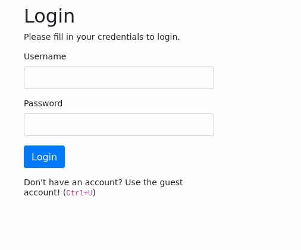
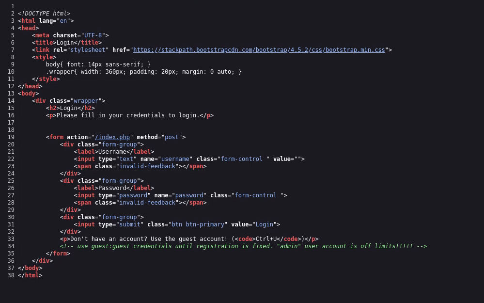

## Exploitation d’une faille IDOR — Neighbour

### Contexte

On nous fournit une adresse IP et pour seule consigne de nous y connecter via le web : `http://10.128.180.33`.  
Pas d’énumération nécessaire ici : on ouvre directement l’URL dans le navigateur et on tombe sur une page de login.

### Accès initial

Avant toute tentative, un réflexe simple : consulter le code source de la page (clic droit → « Afficher le code source », ou `F12`).  
On y trouve un commentaire laissé par un développeur contenant des identifiants de connexion, ainsi qu’une mention indiquant que le compte `admin` est censé être hors d’accès.

On utilise les identifiants `guest:guest` pour se connecter. On arrive alors sur une page de profil :

L’URL est la suivante :  
`http://10.128.180.33/profile.php?user=guest`

### Exploitation (IDOR)

Le profil affiché est directement déterminé par le paramètre `user` dans l’URL, sans contrôle d’autorisation côté serveur. Autrement dit, rien ne vérifie que l’utilisateur connecté a le droit de consulter le profil demandé.

On remplace donc simplement la valeur du paramètre par `admin` :  
`http://10.128.180.33/profile.php?user=admin`

Et on accède au profil administrateur — ainsi qu’au flag.

### Conclusion

Cette room illustre une faille **IDOR (Insecure Direct Object Reference)** : l’application utilise une entrée fournie par l’utilisateur (`user`) pour accéder à une ressource, sans vérifier que celui-ci est bien autorisé à y accéder.

**Remédiation :** contrôler les droits d’accès côté serveur à chaque requête (vérifier que l’utilisateur authentifié a bien la permission de consulter la ressource demandée), plutôt que de se fier à des paramètres manipulables côté client.